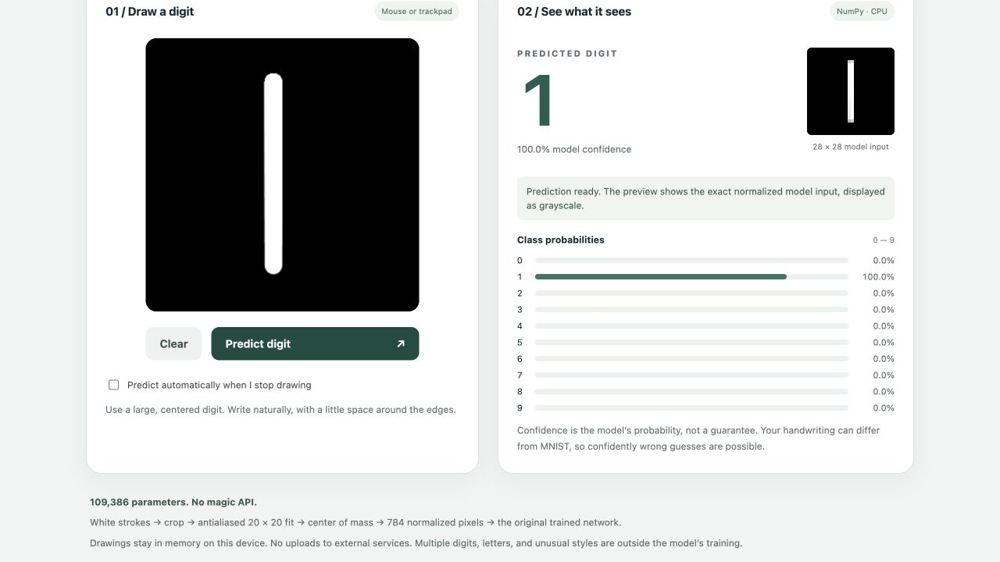

# Neural Network From Scratch

A genuine NumPy implementation of dense neural-network training: manual forward/backpropagation, stable cross-entropy, SGD/momentum, MNIST evaluation, and a separately implemented matching PyTorch baseline. CPU-compatible; no paid services or automatic differentiation in the NumPy implementation.

## macOS quick start

Requires Python 3.11+ and NumPy. Tested with Python 3.12.14 / NumPy 2.3.5 on Apple Silicon macOS. Install Python from https://www.python.org/downloads/macos/ if necessary. In the extracted project directory:

```sh
python3 -m venv .venv
source .venv/bin/activate
python -m pip install -r requirements.txt
make test PYTHON=python
```

PyTorch tests explicitly skip when it is not installed. To reproduce the optional baseline, use a compatible CPU PyTorch wheel (the recorded run used macOS arm64, PyTorch 2.14.1):

```sh
python -m pip install -r requirements-torch.txt
```

PyTorch is optional; the NumPy model does not depend on it. Platform/Python compatibility of the pinned PyTorch wheel varies; if unavailable, run the NumPy-only workflow rather than spending time resolving an optional baseline installation. Linux CPU installation may require PyTorch's CPU package index; this project was tested on macOS only.

## Draw digits locally (no retraining)



After installing the existing NumPy requirement above, run:

```sh
python app.py
```

Open **http://127.0.0.1:8000**. Alternatively use `make draw PYTHON=python`. If port 8000 is busy, run `python app.py --port 8001` and open that port. Stop with Ctrl+C. The existing `checkpoints/numpy_best.npz` is loaded once at startup. PyTorch and Node.js are not required for the drawing app.

Draw one digit with a mouse or trackpad on the black canvas. Automatic prediction is enabled after a 350 ms idle interval between strokes; turn it off to use **Predict digit** manually. **Clear** cancels pending results and empties the canvas. Results show the best digit, all ten class probabilities, confidence, and the exact processed model input (displayed as 8-bit grayscale). New drawing invalidates stale predictions.

Draw large white strokes, leaving room at the edges. Normal mouse/trackpad drag gestures work; pointer events also support touch. The canvas itself is not a keyboard drawing editor. Empty drawings abstain. Confidence is not calibrated: unusual styles, letters, or multiple digits can receive confidently wrong predictions. The reported 97.16% accuracy is from held-out MNIST, **not** a measured accuracy for canvas drawings.

Preprocessing crops visible ink, antialiases to fit a 20×20 region while preserving aspect ratio, pads to 28×28, and translates toward the intensity center of mass without clipping. The row-major normalized `(1,784)` tensor is sent through the unchanged NumPy network. See [PREPROCESSING.md](PREPROCESSING.md) for equations and the API contract.

The server binds only to IPv4 loopback, validates the Host/Origin and bounded JSON payloads, exposes a fixed asset list, and never accepts checkpoint/file paths or executes commands from requests. Drawings are neither stored nor sent to external services. Keep this development server local; it is not hardened for public hosting. Tests that open HTTP ports require local loopback permission.

## Use the supplied results without retraining

Open `results/report.html` in a browser for learning curves, confusion matrices, example predictions, and comparison results. All plots are standalone SVG files. Model checkpoints are included and are less than 0.5 MB each.

```sh
python report.py                   # regenerate plots; no training
python predict.py                 # evaluate saved NumPy checkpoint on MNIST
python predict.py --model checkpoints/pytorch_best.npz
python predict.py --input my_normalized_images.npy
```

Inference inputs must be float pixel rows shaped `(N,784)` in [0,1], white digits on a black background, aligned like MNIST. Arbitrary photos are not preprocessed by this project. The default evaluation command downloads MNIST if absent; `--input` requires no dataset download.

## Reproduce the bounded experiment

```sh
python train.py                   # NumPy only, six epochs
python train.py --torch           # same NumPy run, then matched PyTorch baseline
python report.py
```

Choose one training command; do not run both unless intentionally repeating training. They overwrite checkpoints, metrics, split indices, and small example artifacts in this directory. Running without `--torch` records that the baseline was not requested. The original verified artifacts are already included; repeated training is unnecessary to inspect the project.

Default model: 784→128→64→10, ReLU hidden layers, linear logits; float32; batch 128; learning rate 0.1; classical momentum 0.9; seed 42; six epochs. Original MNIST training examples split into 50,000 train / 10,000 validation (1,000 per class). The official 10,000 test examples remain separate. Lowest validation loss selects the checkpoint; test data never affects training or selection. Pixels divide by 255; no dataset-estimated normalization statistics are needed.

MNIST is downloaded from the public Google-hosted CVDF mirror using HTTPS, checked against known file MD5 digests, and parsed directly from IDX files. Checksums detect corruption; they are not a modern cryptographic authenticity guarantee. Raw datasets are excluded from the ZIP/repository. Dataset background: https://yann.lecun.org/exdb/mnist/ . No claim of dataset ownership is made; the project MIT license covers project code, not third-party datasets or dependencies.

## Measured results

See `results/metrics.json` for exact histories, splits, environment, confusion matrices, and timing notes. Numbers below refer to validation-selected checkpoints from one actual seeded run, not averages over multiple seeds.

| Model | Selected epoch | Train accuracy / loss | Validation accuracy / loss | Test accuracy / loss | Training seconds |
|---|---:|---:|---:|---:|---:|
| NumPy | 3 | 98.20% / 0.05518 | 96.95% / 0.10442 | 97.16% / 0.09058 | 1.149 |
| PyTorch | 6 | 98.98% / 0.03296 | 97.19% / 0.10078 | 97.17% / 0.09561 | 1.059 |

Training times use `perf_counter` and include minibatch training, end-of-epoch train/validation evaluation, and in-memory checkpoint selection copies. Downloads, framework setup/imports, final test evaluation, disk checkpoint writing, and plotting are excluded. NumPy ran first, then PyTorch; no timing repetitions or warmup trials. Thread limits were requested; actual NumPy BLAS thread concurrency was not independently verified. These timings are local observations, not expected runtimes or general performance claims. NumPy uses Apple Accelerate BLAS; PyTorch uses its own kernels.

## Comparison and implementation complexity

Both implementations match architecture, initial weights, seed, data splits, normalized arrays, epoch permutations, batch size, SGD/momentum settings, epoch count, and validation-loss selection rule. NumPy explicitly implements the chain rule, tensor caching, and optimizer state; PyTorch delegates differentiation and optimization to its library. Floating-point kernels differ, so trajectories and selected epochs differ. Native PyTorch metrics are used during training; final baseline metrics use exported parameters with the common NumPy evaluator. Checkpoints share a safe non-pickle NPZ format.

## Structure

- `nn/model.py`: manual network, loss, optimizer, parameter save/load.
- `nn/data.py`: MNIST integrity checks, parsing, splitting, permutations.
- `nn/evaluate.py`: batched loss/accuracy and confusion matrix.
- `train.py`, `baseline.py`, `predict.py`: experiment and inference.
- `report.py`: dependency-light charts/report from measured data.
- `app.py`, `web/`, `nn/preprocess.py`: local drawing UI, inference endpoint, and deterministic image preprocessing.
- `tests/`: finite differences, reference parity, split/IDX validation, determinism, serialization, optimizer and evaluation tests.
- `MATH.md`: matrix dimensions, derivatives, stability, complexity.
- `ARCHITECTURE.md`, `LEARNING_GUIDE.md`, `INTERVIEW_PREP.md`, `RESUME_BULLETS.md`: design and learning material.
- `results/`: measured experiment and verification records; `checkpoints/`: small inference weights.

## Limitations

One six-epoch seed; no uncertainty estimates, adversarial tests, GPU benchmarks, or external handwriting evaluation. No convolutional layers, augmentation, hyperparameter search, exact training resume. Checkpoints save model parameters only. Finite-difference checks validate a small network rather than every MNIST-model parameter. Reproducible configuration does not guarantee identical floating-point outcomes across machines. No GitHub repository has been created or modified for this project.

Project code is MIT licensed; see `LICENSE`. This is an AI-assisted educational project: study, adapt, and explain the implementation before claiming independent authorship.

The original experiment records and `results/TEST_RESULTS.md` remain historical records. Drawing-interface verification is recorded separately in `results/UI_TEST_RESULTS.md` and `results/ui-test-output.txt`; no model retraining or new handwriting-accuracy claim is implied.
